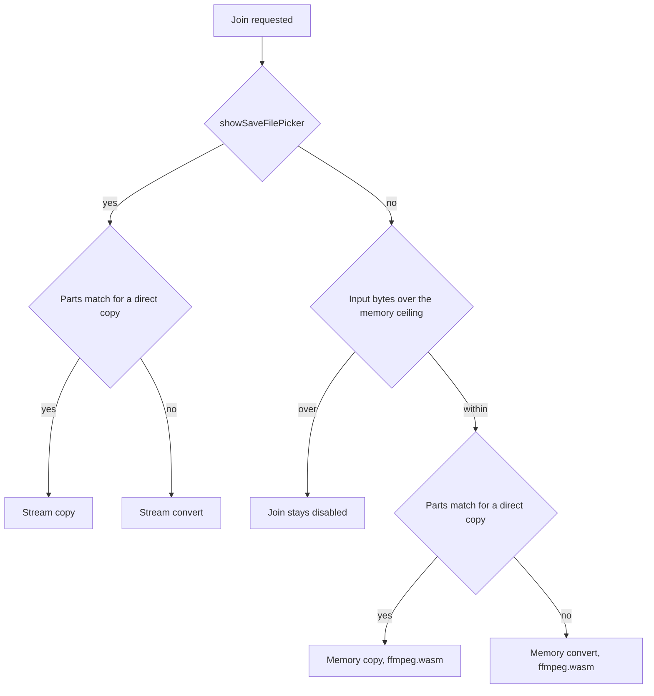

# Concat

Join split match footage in the browser. This is a WebAssembly use case.

It runs FFmpeg compiled to WebAssembly ([ffmpeg.wasm](https://github.com/ffmpegwasm/ffmpeg.wasm)) inside the browser to join the footage. There is no server, and nothing is uploaded.

The WebAssembly module loads only after a join starts, and only for the in-memory path, which keeps the parts and the result in the tab. The streaming path writes the result straight to disk and does not load the module.

Served at [camilaescudero.cl/concat](https://camilaescudero.cl/concat).

## How a join runs

`joinParts` picks one of four paths. Two of them load ffmpeg.wasm. The other two use the File System Access API and [Mediabunny](https://mediabunny.dev/) to read and write media in the browser. Mediabunny's `Conversion` API transcodes with the WebCodecs API. Stream copy does not call it. Nothing is uploaded.

| Path | What it does | Technology | Cost and limits |
| --- | --- | --- | --- |
| Stream copy | Copies encoded video and audio packets into the file chosen in the save picker. It does not re-encode. | Mediabunny packet copy into a `FileSystemWritableFileStream`. Output is written in 8 MiB chunks and is not kept as one in-memory blob. | No WebAssembly download. No byte ceiling in `capacity.ts` (`limitBytes` is null). The stream-copy comment notes that a multi-GB match can finish because the output is not held in memory. |
| Stream convert | Re-encodes each part, then stream-copies those files into the save location. | Mediabunny `Conversion` with `forceTranscode: true` (WebCodecs): AVC video at quality `high`, AAC audio when any part has audio, otherwise audio is discarded. Each part is written to an origin-private temporary file, then removed. The final write is the same chunked stream copy. | No WebAssembly download. No byte ceiling. Every part is decoded and encoded before the copy, so this is the re-encode, not the direct copy. The code sets no timing figure. |
| Memory copy | Writes every part into ffmpeg's filesystem and concatenates with `-c copy`. Returns one `Blob`, which the page downloads. | ffmpeg.wasm. The core script and `.wasm` are fetched from jsDelivr the first time this path runs, then kept until the instance is terminated (cancel terminates it). | Download happens on the join, not when the page opens. Inputs and the output blob stay in the tab. The join is refused when the sum of input sizes is over the memory ceiling below. |
| Memory convert | Re-encodes each part, then concatenates the results with `-c copy`. Also returns a `Blob`. | ffmpeg.wasm, same load as memory copy. Video is libx264 (`veryfast`, CRF 20, yuv420p). Audio is AAC at 160 kb/s, or omitted when the target has no audio. A part with no audio gets silent AAC when the target has audio. | Same wasm download and the same input-size ceiling. The code comment calls this much slower than stream copy because every part is re-encoded inside the module. No measured duration is recorded in the source. |

The memory ceiling applies only when `showSaveFilePicker` is missing. `capacity.ts` then caps the sum of the input file sizes:

| Browser check, in order | Ceiling |
| --- | --- |
| `window` is missing | 1 GiB |
| `showSaveFilePicker` exists | none (streaming) |
| iOS (`iPhone`, `iPad`, or `iPod` in the user agent), or `MacIntel` with `maxTouchPoints > 1` | 400 MiB |
| Safari, and the UA is not Chrome, Chromium, Edge, Opera, or Firefox | 1 GiB |
| Firefox | 1.5 GiB |
| Anything else | 1 GiB |

Those ceilings are the values in code (`400 × 1024²`, `1024³`, and `floor(1.5 × 1024³)`). The comment says an in-memory join holds every part plus the output, and that these caps sit under where each browser tends to kill the tab. The check itself is only the sum of input sizes.



Streaming is chosen only when `showSaveFilePicker` is a function. That check comes before the iOS, Safari, and Firefox tests, so those families are in-memory only when the picker is absent. iOS is one of those memory cases. A streaming join asks for a save location first. Dismissing the picker does not call `joinParts`.

Copy versus convert comes from `compareParts` in `compatibility.ts`, after every part has been read and at least two readable videos are listed. The result is empty when every part can be copied onto the first:

- Video codec, codec parameter, and decoder description match, and each video codec is AVC, HEVC, VP9, AV1, or VP8.
- Display width, height, rotation, and flip match.
- Frame rate matches.
- Video timebase matches.
- Audio is absent on every part, or present on every part with matching codec, codec parameter, description, sample rate, channel count, and timebase. Audio codecs that can be copied are AAC, MP3, Opus, FLAC, AC-3, and E-AC-3.
- Every part after the first starts on a keyframe. The first part is not checked.

Any miss is a difference. An empty list enables **Join**, which calls `joinParts` with `mode: "copy"`. A non-empty list shows the mismatch and **Convert and join**, which calls it with `mode: "convert"`. On the memory path, either button stays disabled when the input total is over the ceiling. Streaming does not apply that ceiling. The convert target is taken from the first video (even width and height, its frame rate, or 30 if the rate is not positive) and the first audio track (its sample rate, or 48000; one channel if the source has one or fewer, otherwise two).

After the attempt, the page posts an anonymous count to `/api/concat-event`. `path` is `"stream"` or `"memory"`. `converted` is true when the action was convert. Those two fields together identify the four paths. The body also includes whether the parts matched, the browser family, part count, input and output bytes, duration, and outcome. It does not include file names or footage.

## Develop

```bash
npm install
npm run dev
```

Open `http://localhost:5173/concat/`.

## Deploy

```bash
npm run build && npx wrangler deploy
```

The build writes the app under `dist/concat/` so assets resolve at `/concat/`. The Worker is assets-only, with SPA fallback, on `camilaescudero.cl/concat` and `camilaescudero.cl/concat/*`.
